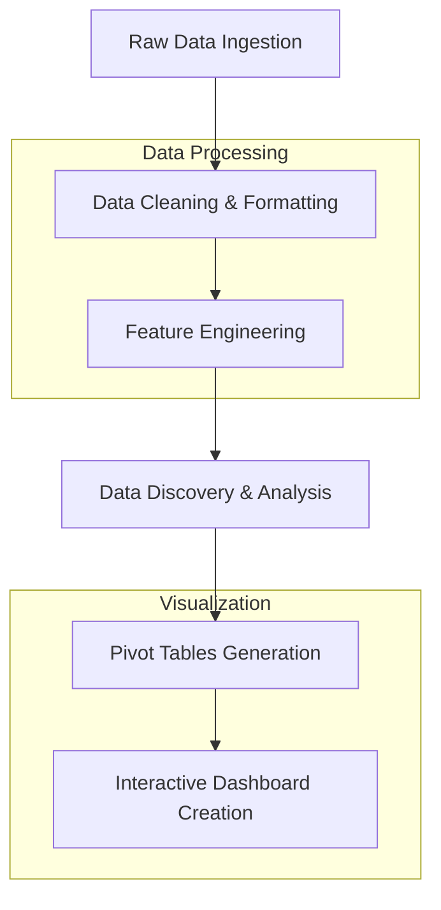

<h1 align="center">Vrinda Store Sales & Analytics Dashboard 🛒</h1>

<p align="center">
  <a href="https://github.com/yourusername/vrinda-store-analysis">
    
  </a>
  <a href="https://github.com/yourusername/vrinda-store-analysis">
    
  </a>
  <a href="https://github.com/yourusername/vrinda-store-analysis">
    
  </a>
</p>

<p align="center">
  <strong>An end-to-end Excel data analytics project focusing on data cleaning, processing, pivot tables, and an interactive dashboard to uncover regional and demographic retail sales trends for the Vrinda Store.</strong>
</p>

---

## 📑 Table of Contents
- [Project Overview](#project-overview)
- [Dashboard Preview](#dashboard-preview)
- [Project Architecture](#project-architecture)
- [Data Dictionary](#data-dictionary)
- [File Structure](#file-structure)
- [Technical Implementation](#technical-implementation)
- [Key Business Insights](#key-business-insights)
- [How to Use](#how-to-use)

---

## 🎯 Project Overview
The primary objective of this project is to analyze the 2022 annual sales data for Vrinda Store. By leveraging advanced Excel capabilities, raw transactional data was transformed into a dynamic, interactive dashboard. This tool empowers stakeholders to make data-driven decisions by understanding customer demographics, channel performance, and geographic revenue distribution.

---

## 📊 Dashboard Preview
The interactive dashboard features dynamic slicers (Date, Category, Gender, Month) to filter multiple Pivot Charts simultaneously.


---

## 🏗️ Project Architecture
The data pipeline and workflow followed a structured analytical approach entirely within Microsoft Excel.



---

## 📖 Data Dictionary
The dataset contains transaction records with the following attributes:

| Column Name | Data Type | Description |
| :--- | :--- | :--- |
| **Order ID** | String | Unique alphanumeric identifier for each transaction. |
| **Cust ID** | Numeric | Unique customer identifier. |
| **Gender** | Categorical | Customer gender (Men/Women). |
| **Age** | Numeric | Customer age in years. |
| **Age Group** | Categorical | *Engineered Feature:* Teenager, Adult, Old. |
| **Date** | Date | Date the order was placed. |
| **Month** | Categorical | *Engineered Feature:* Extracted month for trend analysis. |
| **Status** | Categorical | Order fulfillment status (Delivered, Cancelled, Refunded, Returned). |
| **Channel** | Categorical | Acquisition/Sales channel (Amazon, Myntra, Flipkart, Ajio, etc.). |
| **Category** | Categorical | Product category (Blouse, Bottom, Ethnic Dress, Kurta, etc.). |
| **Size** | Categorical | Apparel size metric. |
| **Amount** | Numeric | Total transaction value in INR. |
| **ship-city / state** | Categorical | Geographic shipping destination. |

---

## 📂 File Structure

| File/Directory | Description |
| :--- | :--- |
| `Vrinda Store Data Analysis.xlsx` | **Main Project File:** Contains the raw data, cleaned dataset, pivot tables, and the final interactive dashboard. |
| `image_d0f247.png` | High-resolution screenshot of the final Excel Dashboard. |
| `README.md` | Project documentation and architectural overview (this file). |

---

## ⚙️ Technical Implementation

### Data Cleaning & Feature Engineering
Several Excel formulas and techniques were utilized to clean the raw data and engineer new features for better aggregation in Pivot Tables.

```excel
/* 1. Standardizing Gender Column */
=IF(OR(C2="M", C2="Men"), "Men", IF(OR(C2="W", C2="Women"), "Women", "Other"))

/* 2. Creating Demographic Bins (Age Group) */
=IF(E2<20, "Teenager", IF(E2<=50, "Adult", "Old"))

/* 3. Extracting Month from Order Date for Time-Series Analysis */
=TEXT(F2, "mmm")
```

### Dashboard Elements
*   **Pivot Tables:** Aggregated data across various dimensions (e.g., Sum of Amount by State, Count of Order ID by Channel).
*   **Pivot Charts:** Donut charts for proportional data (Gender, Status), Line charts for trends (Sales vs. Order over Months), and Bar charts for categorical comparisons.
*   **Slicers & Timelines:** Connected across multiple Pivot Tables using "Report Connections" to ensure the entire dashboard updates dynamically based on user selections.

---

## 💡 Key Business Insights
Based on the dashboard visualizations for 2022:
1.  **Demographics:** Women account for the majority of the sales (**64%**), with the "Adult" age group being the most significant revenue driver for both genders.
2.  **Top Channels:** **Amazon**, **Myntra**, and **Flipkart** are the top-performing sales channels.
3.  **Geographic Focus:** **Maharashtra**, **Karnataka**, and **Uttar Pradesh** represent the top 3 states generating the highest sales volume.
4.  **Order Status:** The vast majority of orders were successfully **Delivered**, though monitoring "Returned" and "Cancelled" slices remains important for operational efficiency.

---

## 🚀 How to Use
1. Clone or download the repository to your local machine.
2. Open `Vrinda Store Data Analysis.xlsx` using Microsoft Excel (2016 or newer recommended for full slicer support).
3. Navigate to the **Dashboard** sheet.
4. Use the **Slicers** (Category, Gender, Month) and the **Timeline** to interactively filter the data and observe how the KPIs and charts update dynamically.